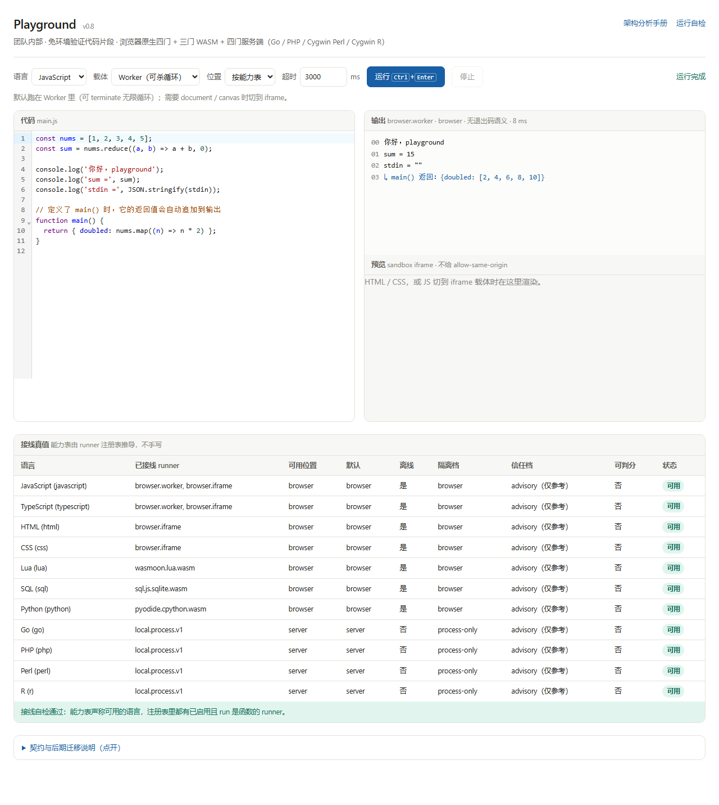

# Playground

浏览器里写代码、点「运行」直接看结果的多语言代码片段验证台。**团队内部小范围使用**，目标是免配环境验证代码片段，不承担判分、不承载不可信代码。

当前 **v0.8 · 11 门语言**：浏览器原生 4 门 + WASM 3 门 + 仅服务端 4 门。契约先行，执行后端可插拔，**能力表由 Runner 注册表推导**，没接线的语言一律置灰。



> 截图取自 v0.8 dev 真机（非设计稿）：默认 JavaScript 示例在 Worker 里跑出输出，下方能力表如实显示每一门的载体、位置、隔离档与信任档。

## 一眼看懂

| 维度 | 做法 |
|---|---|
| 前端 | Vite + TypeScript + CodeMirror 6，无框架；语法包按语言动态 import，不进首屏 |
| 契约 | `RunRequest / RunResult`，`target: 'browser' \| 'server'` 写进请求；统一 `limits / files[] / stdin / outputs / usage / probes / diagnostics` |
| 路由 | `resolveRunner()` 只认 `ExecTarget`，不支持的位置明确拒绝、绝不静默降级；同位置多 Runner 按 `priority` 选 |
| 能力表 | `deriveCapabilities(reg)` + `validateWiring()` 从注册表推导，不手写「我以为能用」 |
| 资产 | wasm 全部 `?url` 自托管、同源显式传 URL，不回退任何 CDN；引擎复用、不预加载 |
| 服务端 | **A′ 本机进程节点**（Go 单二进制、非 Docker），对外是 **Piston v2 兼容子集** |
| 隔离 / 信任 | 服务端一律 `process-only` / `advisory`，**结果不可判分**；`trust` 由 Runner 声明推导，不由 `target` 推 |

## 快速开始

需要 **Node 22+**（真机自检用内置 WebSocket）、**Go**（编译 A′ 节点，同时是 Go 语言运行时）、本机 **Edge / Chrome**（`npm run smoke` 用）。

```bash
npm install                 # postinstall 会把 Pyodide 资产同步到 public/pyodide（不入库）
npm run dev                 # http://127.0.0.1:5173/
```

只用浏览器原生 / WASM 语言，到这一步就够了。要用 Go / PHP / Perl / R，另开一个终端：

```bash
npm run server              # A′ 节点，默认 127.0.0.1:2000，token=pg-local-dev-token
```

前端默认连这个地址；换端口或口令用 `?server=<url>&token=<token>` 覆盖。`Ctrl+Enter` 运行，工具栏可切语言 / 载体 / 位置 / 超时。

服务端语言的**宿主前置**：解释器要在 PATH 里，或在 `servers/local/runtimes.local.json`（本机覆盖、不入库）里写绝对路径；节点每次启动真探测 `GET /api/v2/runtimes`，探测不到就不登记、能力表立刻置灰。入库模板是 `servers/local/runtimes.json`。

## 语言矩阵

| 类别 | 语言 | 载体 | 位置 | 说明 |
|---|---|---|---|---|
| 浏览器原生 | JavaScript / TypeScript | Worker（可切 iframe） | browser | TS 用官方 `transpileModule` 动态加载；`worker.terminate()` 能真杀无限循环 |
| | HTML / CSS | `sandbox="allow-scripts"` iframe | browser | 不给 `allow-same-origin`，靠 `event.source + requestId` 校验回传 |
| WASM | Lua 5.4（wasmoon） | module Worker | browser | 首次运行才加载 wasm |
| | SQL / SQLite（sql.js） | module Worker | browser | 逐行 `step()` 回传，输出限额才真正生效 |
| | Python 3.14（Pyodide core） | module Worker | browser | **仅标准库**，无 wheel / micropip，禁自动装包 |
| 仅服务端 | Go | `local.process.v1` | server | build + run 两阶段 |
| | PHP | `local.process.v1` | server | 单阶段，响应不带 `compile` 字段 |
| | Perl 5.32（Cygwin） | `local.process.v1` | server | 单阶段；本机不在 PATH，靠配置 `path` 挂入 |
| | R 4.2.1（Cygwin） | `local.process.v1` | server | 单阶段；入口是 shell 脚本，由同目录 `sh.exe` 包装 |

`flavor`（如 `cygwin`）由运行时自报、动态探测，不硬编码。Go / PHP / Perl / R 的解释器与节点**一字节都不进前端产物**：v0.8 首屏 JS 17.57 KiB + CSS 1.59 KiB = **19.17 KiB**（`gzip -9` / 1024 口径）。

## 架构骨架

```
RunRequest → resolveRunner(reg, target) → Runner.execute(ctx) → collector → RunResult
                    ↑                            ↑
        deriveCapabilities(reg)          ctx.emit() 流式输出
        validateWiring(reg, caps)        两阶段计时 / 输出限额 / stdin
```

- `src/core/`：契约、注册表、路由、能力表、限额、输出收集（唯一真值在 `contract.ts`）
- `src/runners/browser/`：Worker / iframe / 三门 WASM Runner 及其 module Worker
- `src/runners/server/`：`protocol.ts`（Piston v2 线协议）、`local.ts`（A′）、`piston.ts`（官方后端适配）
- `servers/local/`：A′ 节点源码与运行时配置
- `src/tests/`：单测 + `selftest.ts`（真浏览器端到端判据）
- `scripts/`：节点启动助手、节点判据、真机自检、**拆线负例**
- `docs/ui-screenshot.png`：本页界面截图

**加一门语言的固定五步**：登记 `LangId` / `LANG_DEFS` / `SAMPLES` → 实现或配置 Runner → `createRegistry()` 注入 → CodeMirror 语法包动态 import → 补端到端判据与拆线负例。**UI 一行不改。**

### 决策分叉：为什么不是官方 Docker + Piston

官方 Piston 推荐 `docker run --privileged` + 纯 cgroup v2 + Linux，靠 `isolate`（namespaces / chroot / 多 uid / cgroup）关不可信代码；它**不能 Windows 原生跑、不能脱离 Docker**。本项目只跑团队几个人的可信片段，硬约束是「脱离 Docker + Windows 原生」，因此从 v0.5 起走 **A′ 本机进程执行器**：只绑回环、进程级墙钟 / 输出字节 / 并发 / 临时目录，不做内核隔离。

为将来回切留了三处接缝，换官方后端只需改注入的那一行：

1. `createRegistry(getMount, serverRunners)` 注入 Runner 实例，不绑死 `PistonConfig`；
2. `trusted` 由 Runner 自报的 `trust` 推导（A′ = `advisory`，官方 Piston = `graded`）；
3. 后端专有语言名放在 `PISTON_LANGUAGES` / `LOCAL_LANGUAGES`，不写进 `LANG_DEFS`。

A′ 实现的是 `GET /api/v2/runtimes` + `POST /api/v2/execute` 的 Piston v2 兼容子集（附 `probes` / `output_max_size` 扩展）；`cpu_time / memory` 如实不填，能力缺口登记在 `probes`，不拿 0 冒充用量。

## 验收

| 命令 | 覆盖 |
|---|---|
| `npm run verify` | `tsc --noEmit` + vitest + 构建 |
| `npm run smoke` | 本机 Chromium + CDP 打开 `?selftest=1`，真浏览器端到端判据（dev） |
| `npm run smoke:preview` | **dist 产物**里跑同一套判据（验 wasm / Worker 的另一套资源路径） |
| `npm run check:node` | A′ 节点接口判据：配置路径、动态探测、disabled、PATH 回退、宿主风味、脚本包装 |
| `npm run negative:*` / `npm run smoke:negative:*` | 拆线负例，单测层 8 组 + 真机层 9 组 |

`npm run smoke` 会自动拉起或复用 A′ 节点，并在结束时按「是否由本次拉起」决定是否关闭。

**v0.8 基线**：单测 **93** · 真机 dev / dist 各 **138 条（136 绿 / 2 条记账跳过）** · 节点判据 **46** · **17 组拆线负例全精确** · CDP 抓包 dev 同源 55（`/pyodide/` 4 + `/api/v2/` 2）/ dist 同源 14 / 外部 **0** · `gofmt` / `go vet` 干净。

判据纪律只记三条：押**可观察副作用与可计数的量**；`sample/*` 必须直接跑 `SAMPLES` 默认原文；负例按**红 id 集合 + 相对通过数**比对（押绝对数量，加一门语言老负例必然误报）。

## 使用边界（改之前先重新评估威胁模型）

1. A′ **只绑 `127.0.0.1`**，默认 token 是防本机误调的开发口令，不是安全边界；代码可信是前提，用户代码能读文件、起子进程、联网。
2. **没有内核级网络隔离**；CDP 抓包只覆盖浏览器 target，看不到节点进程，别对外宣称「零外联」。
3. 结果是 `advisory`、**不可判分**。要跑不可信代码、对外开放或用于判分 ⇒ **必须回切官方 Docker + isolate**。
4. 服务端语言依赖宿主机装好解释器，每台机器都要装；版本 / 扩展不一致就无可复现性。

## 真值索引

本文件只做门面与入口，**细节一律以真值文件为准**：

| 文件 | 管什么 |
|---|---|
| `src/core/contract.ts` | 契约唯一真值 |
| `index.html`（折叠说明） | 版本范围、逐语言口径、验收与体积基线 |
| `playground-architecture-analysis.html` | 选型、体积 / 资源账、第十三章 A′ 决策分叉与回切清单 |
| `servers/local/README.md` | A′ 节点手册：接口、运行时路径配置、动态探测、Cygwin 实测与踩坑清单（§8 / §9） |
| `servers/local/runtimes.json` | 运行时路径配置入库模板 |

> 踩坑记录与逐项实测数据刻意不收进本文件，全部留在节点手册 §8 / §9 与架构手册，避免门面文档随时间失真。

---

v0.1 四门浏览器原生 → v0.2 Lua → v0.3 SQL → v0.4 Python → v0.5 A′ + Go → v0.6 规格表 / 动态探测 + PHP → v0.7 Cygwin Perl → **v0.8 Cygwin R（`1df7d43`）**。新语言按门接入、每门独立验收。
